# VLAN, Inter-VLAN Routing, DHCP and ACL Configuration Lab

**Project Status:** Completed  
**Tool:** Cisco Packet Tracer  
**Router:** Cisco 2911  
**Switches:** Cisco 2960

## 1. Project Overview

This project demonstrates a small enterprise network designed and configured using Cisco Packet Tracer.

The network is divided into four separate VLANs to organize departments, improve network segmentation, and control communication between departments.

The lab includes:

- VLAN configuration
- Inter-VLAN routing using Router-on-a-Stick
- DHCP configuration for automatic IP assignment
- 802.1Q trunking between switches and router
- Extended Access Control List (ACL) configuration
- Network connectivity and security testing

## 2. Network Departments and VLANs

| Department | VLAN ID | Network | Default Gateway |
|---|---:|---|---|
| Admin | 10 | 192.168.10.0/24 | 192.168.10.1 |
| Sales | 20 | 192.168.20.0/24 | 192.168.20.1 |
| IT | 30 | 192.168.30.0/24 | 192.168.30.1 |
| HR | 40 | 192.168.40.0/24 | 192.168.40.1 |

## 3. Network Topology

The network contains:

- One Cisco 2911 router
- Two Cisco 2960 switches
- Eight end-user PCs
- Four departmental VLANs

**Connections:**

- Router GigabitEthernet0/2 connects to Switch1 GigabitEthernet0/2.
- Switch1 GigabitEthernet0/1 connects to Switch2 GigabitEthernet0/1.
- Each switch connects to four PCs.

## 4. VLAN Port Assignment

| Switch | Port | VLAN | Department |
|---|---|---:|---|
| Switch1 | Fa0/1 | 10 | Admin |
| Switch1 | Fa0/2 | 20 | Sales |
| Switch1 | Fa0/3 | 30 | IT |
| Switch1 | Fa0/4 | 40 | HR |
| Switch2 | Fa0/1 | 10 | Admin |
| Switch2 | Fa0/2 | 20 | Sales |
| Switch2 | Fa0/3 | 30 | IT |
| Switch2 | Fa0/4 | 40 | HR |

## 5. Inter-VLAN Routing

Router-on-a-Stick was configured using subinterfaces on GigabitEthernet0/2.

| Subinterface | VLAN | Gateway |
|---|---:|---|
| G0/2.10 | 10 | 192.168.10.1 |
| G0/2.20 | 20 | 192.168.20.1 |
| G0/2.30 | 30 | 192.168.30.1 |
| G0/2.40 | 40 | 192.168.40.1 |

Each router subinterface uses IEEE 802.1Q encapsulation.

## 6. DHCP Configuration

Four DHCP pools were configured for Admin, Sales, IT, and HR.

Each pool provides IP addresses from its respective subnet and assigns the correct default gateway.

The address range from .1 to .10 was excluded from DHCP allocation in each subnet.

## 7. Access Control List (ACL)

Extended ACL 100 was configured to enforce the following network policy:

**Policy:** Block traffic from the Sales VLAN (VLAN 20) to the IT VLAN (VLAN 30), while permitting other IP traffic.

Configuration:

```cisco
access-list 100 deny ip 192.168.20.0 0.0.0.255 192.168.30.0 0.0.0.255
access-list 100 permit ip any any
```

The ACL was applied inbound on Router subinterface GigabitEthernet0/2.20.

### ACL Test Result

- Sales-to-IT traffic was blocked.
- The deny rule recorded 4 matches.
- The permit rule recorded 17 matches.
- Other permitted IP traffic was allowed.

## 8. Verification and Testing Results

**Overall Result: Passed**

| Test | Expected Result | Result |
|---|---|---|
| Router subinterfaces | All four gateways show up/up | Passed |
| Switch trunk links | Trunk links operational | Passed |
| DHCP assignment | PCs receive addresses from their correct VLAN subnets | Passed |
| Inter-VLAN connectivity | Permitted VLAN traffic works | Passed |
| Sales-to-IT restriction | Sales cannot reach IT | Passed |
| Other IP traffic | Permitted traffic works | Passed |

All planned lab tests were completed successfully.

## 9. Troubleshooting

During configuration, a DHCP request failure occurred on a client PC.

I used `show ip interface brief` to inspect the router interfaces and identified that the VLAN subinterfaces did not initially have IP addresses configured.

I configured the required subinterfaces with 802.1Q encapsulation and assigned the correct gateway IP addresses.

After configuration, all four router subinterfaces showed an up/up status, and DHCP connectivity was successfully verified.

## 10. Skills Demonstrated

- Cisco Packet Tracer
- VLAN segmentation
- IPv4 addressing and subnetting
- Router-on-a-Stick
- IEEE 802.1Q trunking
- DHCP configuration
- Extended ACL configuration
- Network connectivity testing
- Network troubleshooting
- Basic network security

## 11. Project Evidence

The repository includes:

### Network Topology
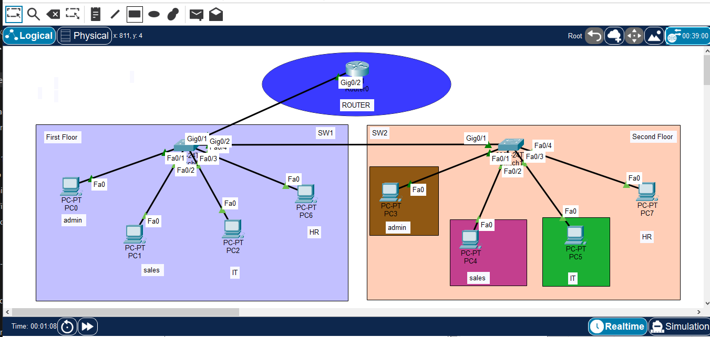

### Router Verification
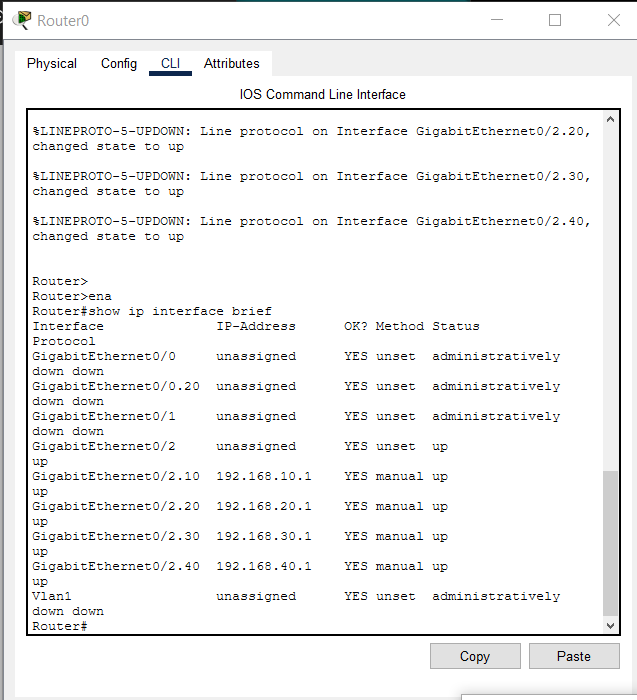

### DHCP Assignment
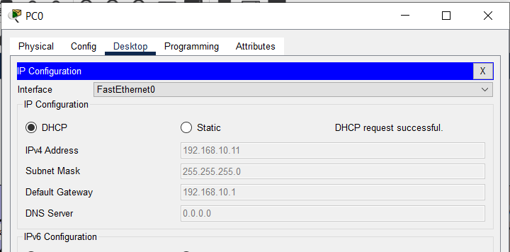

### Sales DHCP Assignment
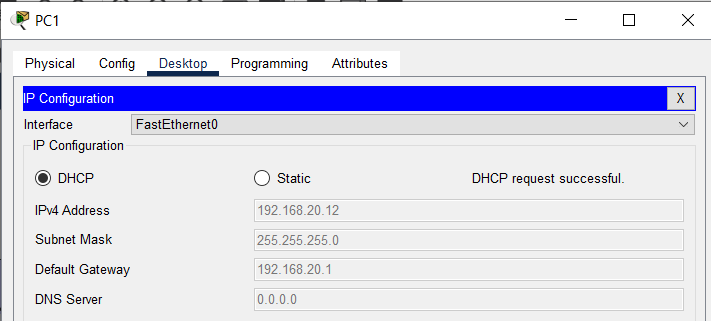

### Switch1 VLAN Verification
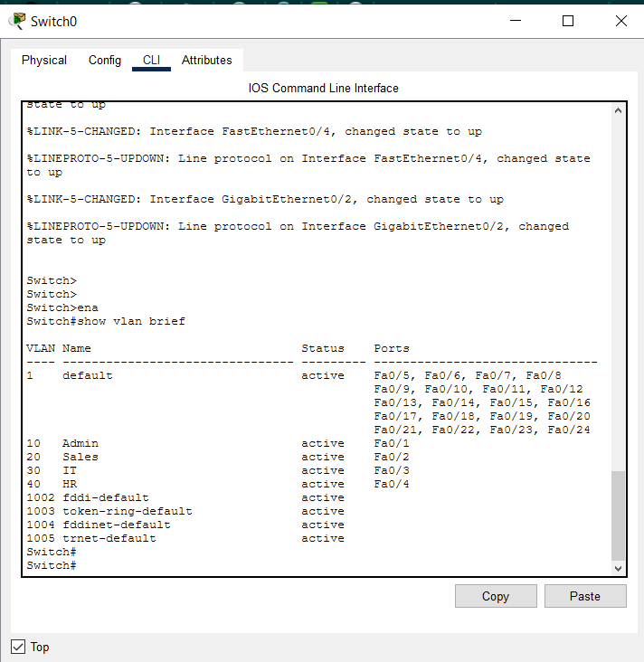

### Switch2 VLAN Verification
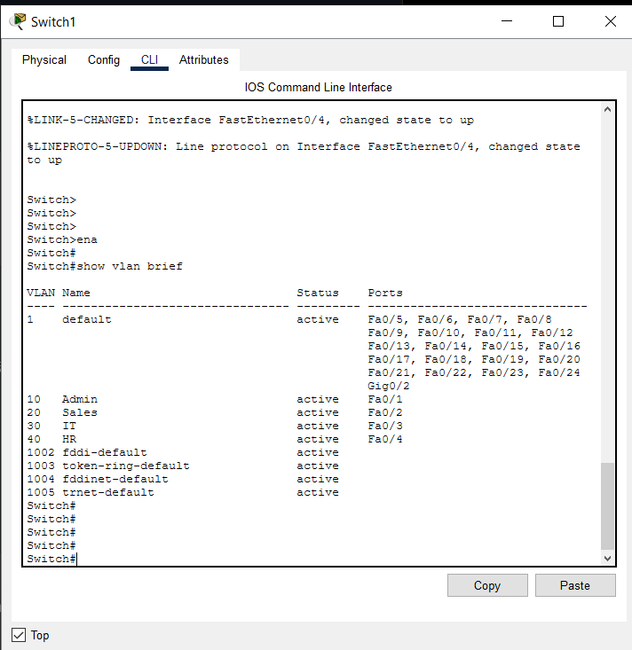

### Switch Trunk Verification
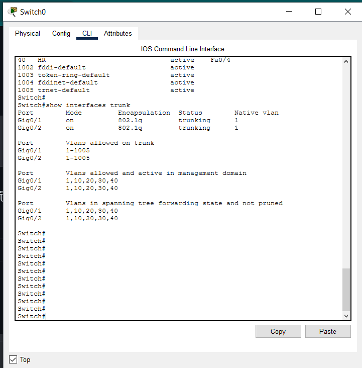

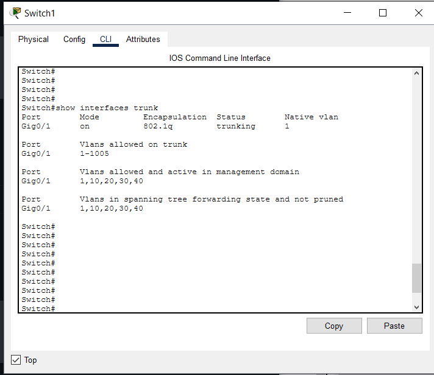

### Inter-VLAN Connectivity
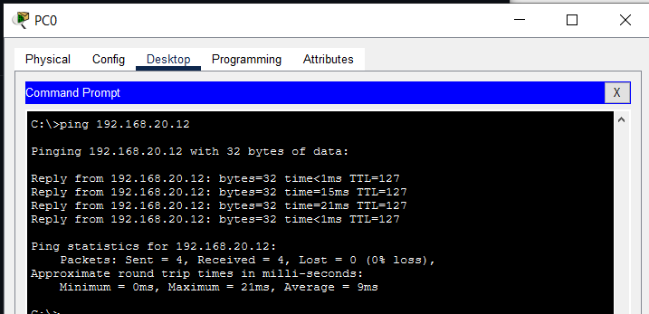

### ACL Connectivity Test
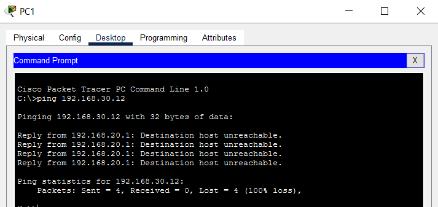

### Inter-VLAN Connectivity


### ACL Verification
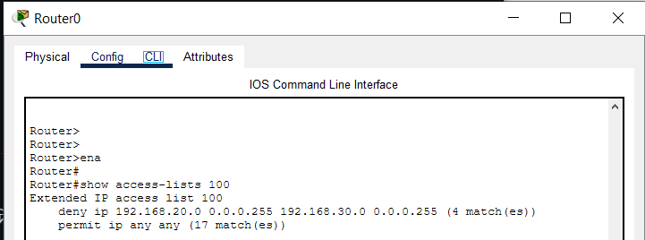

## 12. Conclusion

Successfully designed, configured, and tested a multi-VLAN enterprise network in Cisco Packet Tracer.

The lab demonstrates departmental network segmentation, automatic IP address assignment, inter-VLAN routing, and traffic restrictions using extended ACLs.

